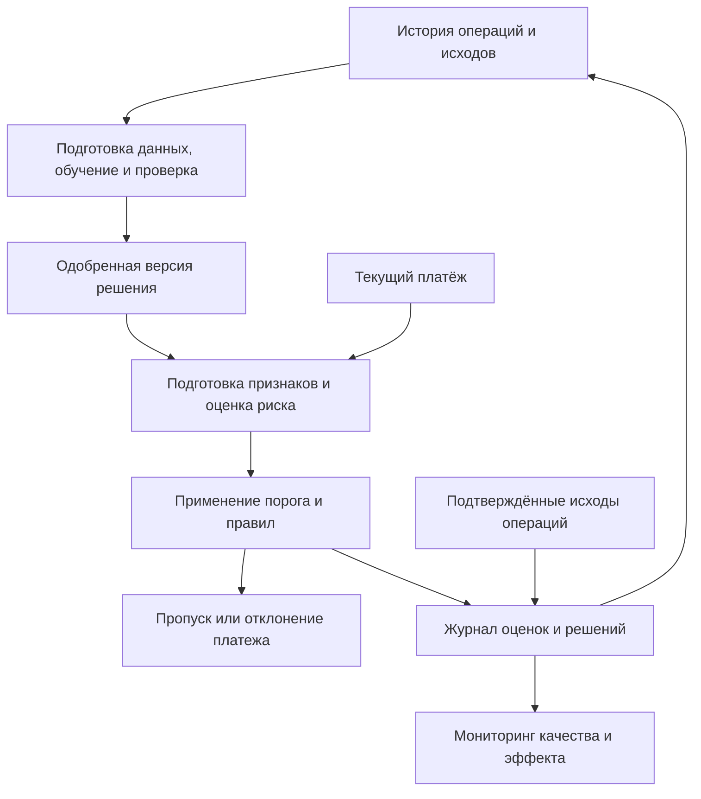

# mlops-antifraud
Учебный проект MLOps: проектирование системы выявления мошеннических онлайн-платежей
# Антифрод-система для онлайн-платежей

Учебный проект курса MLOps

Подготовила Белова С.О. 

21.11.2026

## Описание проекта

Банк столкнулся с ростом мошенничества при онлайн-платежах.
Планируется разработать систему на базе машинного обучения,
которая оценивает риск мошенничества до завершения операции.

На основе оценки риска платёжная система принимает решение
о пропуске или отклонении платежа.

Текущий этап проекта — предварительный анализ и планирование.

## Цели проекта

- Ограничить ущерб клиентов от мошенничества:
  не более 500 тыс. рублей в месяц.
- Обеспечить долю мошеннических операций, приведших к потере
  денежных средств, не более 2% всех транзакций.
- Ограничить долю ошибочно отклонённых легитимных операций:
  не более 5% легитимных операций.
- Оценивать дополнительно предотвращённый ущерб клиентам
  относительно текущего способа защиты.
- Оценивать чистый экономический эффект для банка.

Разработать и внедрить систему оценки риска мошенничества при онлайн-платежах в реальном времени. 
Система должна обеспечивать выполнение целевых показателей по доле успешных мошеннических операций и денежному ущербу, сохраняя долю ошибочных отклонений легитимных платежей в установленных пределах. 
Реализация должна учитывать ограничения по нагрузке, срокам, бюджету, размещению и конфиденциальности данных.

## Ограничения и требования

- Бюджет — до 10 млн рублей без учёта зарплат специалистов.
- Первые результаты — через 3 месяца после старта.
- Завершение проекта при положительном решении — за 6 месяцев.
- Средняя нагрузка — 50 транзакций в секунду.
- Пиковая нагрузка — 400 транзакций в секунду.
- Размещение — на внешних вычислительных ресурсах.
- Необходимо обеспечить конфиденциальность данных клиентов.
- Допустимое время ответа требуется согласовать с заказчиком.

## Метрики проекта

### Метрики машинного обучения

Положительный класс — мошеннические операции.

Обозначения:

- TP — мошеннические операции, правильно выявленные моделью.
- FN — мошеннические операции, пропущенные моделью.
- FP — легитимные операции, ошибочно признанные мошенническими.
- TN — легитимные операции, правильно признанные легитимными.

| Метрика | Формула | Назначение |
|---|---|---|
| Recall — полнота обнаружения | TP / (TP + FN) | Основная метрика: максимизировать при FPR ≤ 5% |
| Precision — точность обнаружений | TP / (TP + FP) | Контролировать обоснованность тревог |
| FPR — доля ложных срабатываний | FP / (FP + TN) | Ограничить ошибочные отклонения легитимных платежей: ≤ 5% |
| Accuracy — доля правильных ответов | (TP + TN) / (TP + TN + FP + FN) | Использовать справочно |

Основная метрика — Recall при ограничении FPR ≤ 5%.
Она отражает способность обнаруживать мошенничество
с учётом допустимой доли ошибочных блокировок.

Accuracy не подходит в качестве основной метрики:
при преобладании легитимных операций высокий результат
возможен даже при пропуске всего мошенничества.

Порог принятия решения подбирается на проверочных данных.
Итоговая оценка проводится на отдельном тестовом периоде,
не использованном для обучения и настройки.

### Бизнес-метрики и экономический эффект

| Метрика | Способ расчёта | Целевой ориентир |
|---|---|---|
| Доля мошеннических операций с потерей средств | Количество мошеннических операций, приведших к потере средств / количество всех транзакций за согласованный период | ≤ 2% |
| Фактический ущерб клиентам | Сумма потерь клиентов от мошеннических операций за месяц | ≤ 500 тыс. рублей в месяц |

Сумма заблокированных платежей не равна предотвращённому
ущербу. Необходимо учитывать подтверждённое мошенничество
и оценивать дополнительный результат относительно прежней защиты.

В расчёт эффекта для банка включаются затраты на разработку,
инфраструктуру и эксплуатацию, а также изменение дохода
из-за ошибочных блокировок. Одни и те же потери и расходы
не должны учитываться повторно.

Сохранённые деньги клиентов и экономический эффект банка
оцениваются отдельно.

Качество модели само по себе не гарантирует достижение
денежных целей: Recall учитывает количество операций,
но не различает их по размеру возможного ущерба.

## Анализ проекта: Machine Learning Canvas

Для анализа используется адаптированный Machine Learning Canvas.
Он связывает бизнес-цели, решения системы, данные и проверку качества.

Источник подхода: https://www.ownml.co/machine-learning-canvas

## Анализ проекта по Machine Learning Canvas

Автор шаблона — Louis Dorard, OWNML.
Версия — 1.2.
Источник — https://www.ownml.co/machine-learning-canvas
Лицензия шаблона — CC BY-SA 4.0.

Ниже представлены предварительные проектные решения.
Допущения и неизвестные условия требуют согласования с заказчиком.

### 1. Value Proposition — Ценностное предложение

- Получатели пользы — клиенты банка и банк.
- Проблема — потери денег при мошеннических онлайн-платежах
  и недовольство клиентов из-за ошибочных блокировок.
- Ожидаемая ценность — сокращение ущерба клиентам
  при допустимой доле ошибочных отклонений платежей.
- Встраивание в процесс — оценка риска передаётся платёжной
  системе до завершения операции.
- Для сотрудников антифрода предлагается доступ к журналу
  решений и отчётности. Конкретного владельца процесса
  и требования к интерфейсам необходимо уточнить.

### 2. Prediction Task — Задача предсказания

- Тип задачи — бинарная классификация.
- Объект предсказания — отдельная онлайн-транзакция.
- Целевые классы — мошенническая и легитимная операция.
- Результат модели — оценка риска мошенничества.
- Предсказание формируется до завершения платежа.
- Фактический исход устанавливается на основании подтверждённых
  сведений о мошенничестве. Источник, правила подтверждения
  и задержку появления этих сведений необходимо определить.

### 3. Decisions — Решения

- Платёжная система использует оценку риска для пропуска
  или отклонения операции.
- Порог принятия решения подбирается на проверочных данных
  с целью максимизации Recall при FPR ≤ 5%.
- Правила применения порога согласуются с заказчиком.
- Необходимо определить действия при недоступности модели,
  превышении времени ожидания или неполных данных.
- Для оценки эффекта требуется согласовать способ сравнения
  с действующей защитой, учитывающий, что блокировка меняет
  наблюдаемый исход операции.

### 4. Impact Simulation — Моделирование эффекта

До внедрения моделируется применение решения к историческим
операциям с известными исходами.

Учитываются следующие последствия:

- Верное выявление мошенничества — возможность предотвратить
  денежные потери.
- Пропуск мошенничества — возможный ущерб клиенту и банку.
- Ошибочная блокировка — неудобство клиенту, возможная потеря
  дохода и дополнительные обращения в поддержку.
- Верный пропуск легитимного платежа — сохранение возможности
  провести операцию и получить связанный с ней доход.

Расчёт выполняется с учётом сумм операций и сравнения
с текущим способом защиты. Сумма заблокированных платежей
не приравнивается автоматически к предотвращённому ущербу.

Критерии готовности к внедрению:

- Выполнение ограничения FPR ≤ 5% на итоговой проверке.
- Обоснованная оценка возможности достижения бизнес-целей:
  ущерб до 500 тыс. рублей в месяц и доля мошеннических
  операций с потерей средств до 2% всех транзакций.
- Приемлемые результаты нагрузочных проверок.
- Оценка затрат и ожидаемого экономического эффекта.
- Согласование требований к защите данных.

Стоимость ошибок и методику денежной оценки необходимо уточнить.
Также требуется определить допустимые различия в качестве
и ошибочных блокировках между значимыми группами клиентов.

### 5. Data Sources — Источники данных

- Подтверждённый источник — исторические CSV-файлы,
  содержащие сведения о транзакциях и клиентах.
- Требуемый дополнительный источник — сведения
  о подтверждённом мошенничестве и фактических потерях.
  Их наличие и формат пока не подтверждены.
- Для работы в реальном времени потребуется источник данных
  о текущей операции до её завершения.
- Конкретные поля, глубина истории, идентификаторы для связывания
  данных и способ передачи текущих операций требуют уточнения.

### 6. Data Collection — Сбор данных

- Организовать первоначальную загрузку исторических CSV.
- Проверять структуру, типы данных, пропуски и дубли.
- Связывать операции с подтверждёнными исходами.
- Настроить регулярное получение новых операций
  и обновление сведений об их исходах.
- Сохранять версии наборов данных для воспроизводимости.
- Обеспечить защиту при передаче и хранении,
  ограничить доступ к конфиденциальным сведениям.
- Согласовать частоту обновления, сроки хранения,
  допустимую задержку и стоимость обработки данных.

### 7. Features — Признаки модели

Возможные признаки при наличии соответствующих данных:

- Сумма и время операции.
- Характеристики получателя и канала платежа.
- Количество и сумма предыдущих операций клиента
  за согласованные интервалы.
- Отклонение суммы платежа от привычных значений клиента.
- Другие характеристики, доступные до завершения операции.

Состав признаков определяется после изучения данных.

Все агрегаты рассчитываются только по информации,
доступной на момент предсказания. Подтверждение мошенничества
после операции используется как целевая метка, а не входной признак.

Правила подготовки признаков при обучении и эксплуатации
должны быть согласованы и версионироваться.

### 8. Building Models — Построение моделей

- Сформировать базовое решение для сравнения
  и обучить несколько моделей-кандидатов.
- Разделить данные по времени на обучение,
  настройку и итоговую проверку.
- Выбрать модель и порог по Recall при FPR ≤ 5%,
  дополнительно оценив денежные последствия ошибок.
- Для первой версии предполагается одна действующая модель.
- Сохранять версии модели, подготовки признаков,
  порога и результатов проверки.
- Предусмотреть возврат к предыдущей рабочей версии.
- Обучение выполнять на внешних вычислительных ресурсах.
  Требуемую конфигурацию и длительность определить экспериментально.
- Периодичность переобучения и условия внепланового обновления
  установить по результатам пилота и мониторинга.

### 9. Making Predictions — Получение предсказаний

- Режим — обработка каждой текущей операции в реальном времени.
- Средняя нагрузка — 50 транзакций в секунду.
- Пиковая нагрузка — 400 транзакций в секунду.
- Оценка должна поступать до завершения платежа.
- Допустимое время ответа согласовать для всей цепочки:
  получение данных, расчёт признаков, инференс
  и принятие решения.
- Размещение — на внешних вычислительных ресурсах.
- Конфигурацию, масштабирование и резервирование определить
  по результатам нагрузочных проверок.
- Исторические CSV используются для обучения и анализа;
  механизм проверки текущих платежей проектируется отдельно.

### 10. Monitoring — Мониторинг

После запуска контролируются:

- Качество модели — Recall, Precision, FPR;
  Accuracy используется справочно.
- Результаты для клиентов — фактический ущерб,
  доля мошеннических операций с потерей средств
  и дополнительно предотвращённый ущерб.
- Результаты для банка — чистый экономический эффект.
- Работа сервиса — время ответа, ошибки,
  доступность и обработанная нагрузка.
- Данные — пропуски, изменения структуры и распределений,
  доступность признаков и задержка подтверждения исходов.
- Расходы на инфраструктуру и эксплуатацию.

Предварительная периодичность:

- Технические показатели и критические нарушения —
  непрерывное наблюдение и уведомления.
- Качество данных и модели — регулярная проверка
  с учётом задержки подтверждения мошенничества.
- Экономические показатели — ежемесячный анализ.

Необходимо согласовать пороги уведомлений, ответственных,
условия пересмотра модели и порядок реагирования.

## Декомпозиция системы

Предварительно выделены семь функциональных частей.
Конкретные технологии выбираются после уточнения требований
и изучения данных.

| Часть системы | Основные функции | Результат |
|---|---|---|
| Сбор и хранение данных | Загрузка CSV, проверка структуры и качества, связывание транзакций с подтверждёнными исходами | История операций для обучения и анализа |
| Подготовка признаков | Преобразование данных и расчёт характеристик, доступных на момент операции | Входные признаки модели |
| Обучение и оценка | Обучение кандидатов, подбор порога, сравнение с базовым решением и итоговая проверка | Модель-кандидат и отчёт о качестве |
| Управление версиями и выпуском | Хранение версий модели, подготовки признаков и порога; выпуск одобренного решения и откат | Воспроизводимая рабочая версия |
| Сервис оценки риска | Получение текущей операции, подготовка признаков и применение модели | Оценка риска мошенничества |
| Принятие решения и интеграция | Применение порога и правил, передача решения платёжной системе, обработка сбоев | Пропуск или отклонение платежа |
| Обратная связь и мониторинг | Сбор подтверждённых исходов, расчёт метрик, контроль данных, работы сервиса и затрат | Информация для контроля и обновления системы |

### Схема взаимодействия

### Обучение и применение модели

Обучение выполняется на накопленных исторических данных.
Результат — проверенная версия модели с правилами подготовки
признаков и порогом принятия решения.

При поступлении нового платежа сервис рассчитывает признаки
и применяет уже обученную модель. Этот процесс называется
инференсом. Обучение заново для каждого платежа не выполняется.

Подтверждённые исходы могут появляться с задержкой.
После их получения они связываются с сохранёнными оценками
и решениями для проверки качества и следующего обучения.

### Общие требования к компонентам

- Подготовка признаков при обучении и эксплуатации
  должна следовать одинаковым правилам.
- Для каждого решения сохраняются идентификатор операции,
  версия модели, версия подготовки признаков,
  оценка риска и применённый порог.
- Время ответа проверяется для всей цепочки обработки,
  включая получение данных и расчёт признаков.
- Действия при недоступности сервиса, задержках
  и неполных данных согласуются с заказчиком.
- Защита данных обеспечивается при передаче,
  хранении, обработке и ведении журналов.
- Для рабочей версии предусматривается возможность отката.

- ## План реализации

Пять задач проекта размещены на Kanban-доске.
Сроки предварительные и отсчитываются от старта проекта.

[Открыть доску проекта](https://github.com/users/StacyBelova/projects/1)
